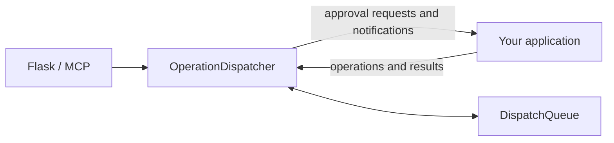
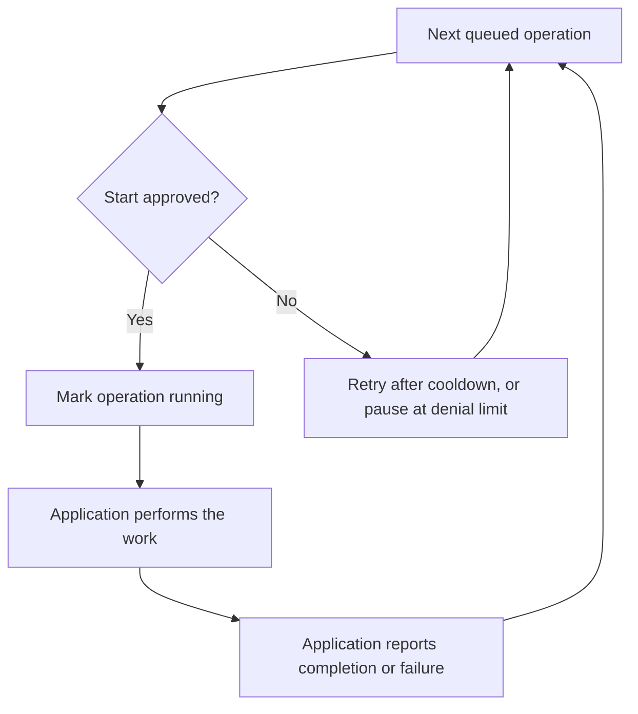

# Operation Dispatcher

[](https://pypi.org/project/operation-dispatcher/)
[](https://pypi.org/project/operation-dispatcher/)

Operation Dispatcher is a lightweight Python framework for scheduling and supervising operations for a **single resource**, such as a robot, machine, workstation, or transport vehicle. Each dispatcher maintains a queue, allows at most one active operation, requests approval for lifecycle actions, and records events and operation history.

Your application performs the actual work and reports completion or failure. The dispatcher coordinates that work; adding an operation or approving its start does not execute its payload.

## Highlights

- Configurable queue ordering by release date, priority, and creation time, with dependency ordering
- Async runtime with event wakeups and release-date/retry-cooldown waits
- Request callbacks for start, cancel, pause, resume, and remote completion decisions
- Separate execution state, outcome, and termination reason
- Validated operation updates with field-level change events
- In-memory history, optional external history retrieval, diagnostics, and visualization
- Optional Flask/Swagger and FastMCP interfaces

## Architecture

The dispatcher manages the queue and operation lifecycle. Your application supplies business decisions, performs the work, and reports the result. Optional Flask and MCP interfaces expose control and inspection.



## Dispatch flow

One operation runs at a time. When the dispatcher is unpaused and idle, it waits for the queue head's release date and any retry cooldown before requesting approval.



Lifecycle events record what happened along the way. A paused operation keeps the active slot until it is completed, failed, or cancelled.

Scheduling behavior:

- Default ordering is `release_date` ascending (missing dates last), then `priority` descending, then `created_at` ascending. Supply `dispatch_queue_sort_rules` using `SortRule`, `SortField`, and `SortDirection` to customize it.
- `FINISH_TO_START` and `START_TO_START` dependencies both order providers before dependents **within the queued operations**. Cycles fall back to the configured sort order. Missing providers and their execution outcomes are not checked; enforce external dependency requirements in your request callback.
- A future release date or denied start on the queue head holds up later operations.
- `planned_duration` and `due_date` are metadata, not automatic completion or timeout triggers. Model timestamps are normalized to UTC; naive datetimes are treated as UTC.

## Installation

Requires **Python 3.12–3.15** (`>=3.12,<3.16`). CI tests each minor version. From this checkout:

```bash
python -m pip install -e .
```

Install extras as needed (quote brackets when using shells such as zsh):

```bash
python -m pip install -e '.[dev]'       # tests, lint, build, metadata checks
python -m pip install -e '.[api]'       # Flask + Flasgger
python -m pip install -e '.[mcp]'       # FastMCP
python -m pip install -e '.[vis]'       # Plotly + NumPy + pandas
python -m pip install -e '.[dev,api,mcp,vis]'
```

## Quickstart

This example explicitly performs one dispatch step, simulates application work, and reports completion. Without a request callback, lifecycle requests are approved by default, except remote completion requests, which require explicit approval.

```python
import asyncio

from operation_dispatcher import DispatchEvent, Operation, OperationDispatcher


def on_notification(event: DispatchEvent) -> None:
    print(f"{event.event_type.value}: {event.operation_id}")


async def main() -> None:
    dispatcher = OperationDispatcher(
        resource_id="robot-1",
        on_notification_callback=on_notification,
    )
    operation = Operation(
        resource_id="robot-1",
        payload={"task": "pickup"},
        priority=10,
    )
    dispatcher.add_operation(operation)

    started = await dispatcher.step_dispatch()
    if started is not None:
        await asyncio.sleep(0.1)  # Replace with your resource integration.
        dispatcher.complete_operation(started.id)

    history = dispatcher.get_history(resolve_operations=True)
    print(history.model_dump_json(indent=2))


asyncio.run(main())
```

For continuous dispatch, start `runtime_task = asyncio.create_task(dispatcher.run())` in your asyncio application. Your resource integration must still call `complete_operation()` or `fail_operation()` for each active operation. To stop, call `dispatcher.request_stop()` and then `await runtime_task`. Stopping the loop preserves queued and active operations; it does not cancel them.

## Request decisions and notifications

`on_request_callback(event)` handles `OPERATION_START_REQUESTED`, `OPERATION_CANCEL_REQUESTED`, `OPERATION_PAUSE_REQUESTED`, `OPERATION_RESUME_REQUESTED`, and `OPERATION_COMPLETE_REQUESTED`. It can be synchronous or asynchronous. Retrieve the operation using `dispatcher.get_operation(event.operation_id)` when your decision needs its payload.

Return `True`/`False`, a `RequestDecision` (exported from the package root), or a dictionary decision with a real boolean `accepted` field. Strings and numeric values are not coerced:

```python
from operation_dispatcher import DispatchEvent, EventType


def on_request(event: DispatchEvent) -> bool | dict[str, object]:
    if event.event_type is EventType.OPERATION_START_REQUESTED:
        return {
            "accepted": False,
            "reasoning": "resource_not_ready",
            "data": {"interlock": "loading_bay"},
        }
    return True
```

Pass it as `on_request_callback=on_request` when constructing the dispatcher. A configured callback returning `None` or another unsupported value **denies** the request. Callback exceptions and timeouts also produce denials. The request timeout defaults to 5 seconds; a timed-out synchronous callback may continue running in its worker thread.

Retry state is tracked per operation and request type. Defaults are a 1-second cooldown and a pause after 5 denials, configured by `request_retry_cooldown_seconds` and `request_max_retries`. The same policy applies to cancel, pause, and resume requests. The original `start_request_*` names remain compatibility aliases; the new names take precedence if both are supplied. Start requests are retried by the runtime; other actions require another caller invocation. Completion requests are evaluated individually, without cooldowns, retries, or pausing the dispatcher after denials. `resume_dispatcher_runtime()` clears all request retry state.

`on_notification_callback(event)` observes dispatcher lifecycle events, operation transitions/updates, and denials. It supports synchronous and asynchronous callbacks; asynchronous notifications are scheduled without waiting for completion. Failures are logged. Synchronous notifications should return promptly; shutdown does not drain pending notifications. `*_REQUESTED` events are recorded in history **after the decision**, with `meta_data["request_decision"]`, and are not sent to the notification callback. Denial events include any supplied reasoning/decision data and, except for completion requests, retry metadata.

### Remote completion approval

`request_operation_completion(id, outcome, termination_reason=None, meta_data=None)` requests approval to finish the current running or paused operation. It returns the completed `Operation` on approval or `None` on denial; invalid commands raise `ValueError`, unknown IDs raise `LookupError`, and ineligible operations raise `RuntimeError`. In async applications, use `await asyncio.to_thread(dispatcher.request_operation_completion, id, outcome)` to keep the event loop responsive.

For this request, a missing callback, invalid return value, exception, or timeout denies completion. The callback receives the requested `outcome` and resolved `termination_reason` in `event.meta_data`, alongside caller metadata. These two fields and `request_decision` are reserved for dispatcher-generated values. For example:

```python
def on_request(event: DispatchEvent) -> bool | dict[str, object]:
    if event.event_type is EventType.OPERATION_COMPLETE_REQUESTED:
        # Apply application policy and ensure execution can safely finish.
        allowed = application.can_finish(event.operation_id, event.meta_data["outcome"])
        return {"accepted": allowed, "reasoning": "application_completion_policy"}
    return True
```

The callback returns a decision; the dispatcher performs completion. Approval produces `OPERATION_COMPLETED` for success or `OPERATION_FAILED` for failure; denial produces `OPERATION_COMPLETE_DENIED` and preserves the operation. Approval does not itself stop resource execution: coordinate that in the application. If local execution or another request completes the operation while approval is pending, the remote request returns a conflict without overwriting the result. An accepted decision in history therefore does not necessarily mean the transition succeeded.

Existing `complete_operation()` and `fail_operation()` remain direct result-reporting methods and do not invoke approval callbacks.

All added operations are copied and validated. Reads and command results return detached snapshots, including `current_operation`, `get_schedule()`, `dispatch_queue`, history, and events. Compare operation IDs and fetch fresh snapshots to observe changes; use facade commands to make changes. Approval callbacks run outside the state lock; concurrent edits or completion invalidate stale approvals. See [the migration guide](docs/MIGRATING_TO_1_0.md) for callback threading, shutdown, and public interface contracts.

## Models and lifecycle methods

Runtime tracking is part of `Operation`; there is no separate `OperationExecution` model.

| Model | Purpose |
| --- | --- |
| `Operation` | Payload, resource/job IDs, scheduling fields, execution state/outcome, timestamps, and retry count |
| `OperationDependency` | Provider operation ID and dependency type |
| `DispatchEvent` | Event type, resource/operation IDs, timestamp, metadata, and field-level `changes` |
| `OperationDispatcherState` | Running/paused flags, queued count, active operation, and uptime |
| `History` | Selected events, time window, and optionally referenced operations |

Execution state and terminal outcome are separate:

| Action | `state` | `outcome` |
| --- | --- | --- |
| Add a default operation | `QUEUED` | `NONE` |
| Approved start | `RUNNING` | `NONE` |
| Approved operation pause | `PAUSED` | Unchanged |
| Approved operation resume | `RUNNING` | Unchanged |
| `complete_operation(id)` | `COMPLETED` | `SUCCESS` |
| `fail_operation(id)` | `COMPLETED` | `FAILURE` |
| Approved `cancel_operation(id)` | `COMPLETED` | `CANCELLED` |

`termination_reason` supplies detail such as `USER_REQUEST`, `TIMEOUT`, `INTERNAL_ERROR`, or `EXTERNAL_ERROR`. Failure and cancellation default to `INTERNAL_ERROR`; pass an explicit reason when appropriate.

- `add_operation(operation)` validates the resource ID and queues it. `default_planned_duration` fills a missing duration unless disabled for that add call.
- `update_operation(id, updates)` accepts `payload`, `priority`, `release_date`, `planned_duration`, `due_date`, and `dependencies`, reorders the queue, and emits `OPERATION_UPDATED` when values differ. Lifecycle fields cannot be updated. Running and completed operations reject updates; `updatable_fields` can further restrict the allowlist (available as `dispatcher.updatable_fields`).
- `pause_operation(id)` / `resume_operation(id)` request approval for the current operation and enforce its expected state by default.
- `cancel_operation(id)` requests approval for a queued or active operation. Completion and failure require the current operation and do not request approval.
- `get_schedule()` returns queued operations only; `current_operation` returns the active one. `get_operation(id)` also searches archived operations.

`pause_dispatcher_runtime()` blocks new dispatches and leaves active-operation state unchanged. `resume_dispatcher_runtime()` unblocks dispatch and clears retries. Use `pause_operation(id)` and `resume_operation(id)` for approved active-operation state changes. The application remains responsible for stopping or resuming the physical resource.

## Events and history

All event enum names below use the `OPERATION_` prefix; serialized values are lowercase, for example `operation_started`.

| Group | Event names |
| --- | --- |
| Dispatcher lifecycle | `OPERATION_DISPATCHER_STARTED`, `OPERATION_DISPATCHER_STOPPED`, `OPERATION_DISPATCHER_PAUSED`, `OPERATION_DISPATCHER_RESUMED` |
| Requests | `OPERATION_START_REQUESTED`, `OPERATION_CANCEL_REQUESTED`, `OPERATION_PAUSE_REQUESTED`, `OPERATION_RESUME_REQUESTED`, `OPERATION_COMPLETE_REQUESTED` |
| Denials | `OPERATION_START_DENIED`, `OPERATION_CANCEL_DENIED`, `OPERATION_PAUSE_DENIED`, `OPERATION_RESUME_DENIED`, `OPERATION_COMPLETE_DENIED` |
| Operation lifecycle | `OPERATION_ADDED`, `OPERATION_UPDATED`, `OPERATION_STARTED`, `OPERATION_PAUSED`, `OPERATION_RESUMED`, `OPERATION_COMPLETED`, `OPERATION_FAILED`, `OPERATION_CANCELLED` |

Configure in-memory event retention once when constructing the dispatcher:

```python
dispatcher = OperationDispatcher(resource_id="robot-1", event_history_limit=5000)
```

`event_history_limit` must be a positive integer and defaults to **1,000**. It limits the total retained events across the dispatcher, including operation and dispatcher lifecycle events; the oldest events are discarded first. The value is available as `dispatcher.event_history_limit` and is shared by the event/history services, OpenAPI, and MCP. Archived operations are retained separately and are unaffected by event eviction. Call `dispatcher.prune_completed_operations(keep=100)` to keep the newest 100 completed operations; the method returns the number removed and preserves queued/active operations and retained events. There is no built-in durable persistence.

An attached `BrowserEventVisualizer` inherits this limit unless its existing `max_events` option explicitly overrides it. A standalone visualizer defaults to 1,000 events.

`get_history(from_time=None, to_time=None, resolve_operations=False, limit=None)` returns events in recorded order. Time bounds filter the selection; `limit` keeps the most recent matching events. With `resolve_operations=True`, the result includes detached snapshots of the latest known operation records referenced by those events, rather than their values at event time. Pruned records are omitted.

For external history storage, supply `on_history_callback(from_time, to_time, resolve_operations, limit, in_memory_history)`. Return a `History` to override the in-memory selection, or `None` to keep it. Use notifications to integrate persistence for non-request events; request decisions remain available through history.

```python
from operation_dispatcher import HistoryAnalyzer, show_history_gantt

history = dispatcher.get_history(resolve_operations=True)
print(HistoryAnalyzer(history).get_report())
show_history_gantt(history, title="Dispatcher History")  # Requires .[vis].
```

`HistoryAnalyzer` reports dispatcher uptime and unpaused runtime in seconds and percentages. `BrowserEventVisualizer` provides a live browser view of events; the Plotly helpers build/show a history Gantt chart.

## Flask / OpenAPI interface

`OperationDispatcherOpenAPI.register_default_endpoints(app)` registers:

| Method | Route | Behavior |
| --- | --- | --- |
| GET | `/operations` | Active and queued operations; optional `state=QUEUED`, `RUNNING`, or `PAUSED` |
| GET | `/operations/current` | Current active operation |
| GET | `/operations/history` | Event history with optional referenced operations |
| GET | `/operations/<operation_id>` | Operation lookup, including archived operations |
| GET | `/operations/<operation_id>/events` | Retained in-memory events for the operation |
| POST | `/operations/add` | Add a non-empty list of operation objects |
| POST | `/operations/<operation_id>/update` | Update allowed operation fields |
| POST | `/operations/<operation_id>/cancel` | Request cancellation |
| POST | `/operations/<operation_id>/complete` | Request approved completion with `SUCCESS` or `FAILURE` |
| POST | `/operations/<operation_id>/pause` | Request operation pause |
| POST | `/operations/<operation_id>/resume` | Request operation resume |
| GET | `/dispatcher` | Dispatcher/runtime state |
| POST | `/dispatcher/pause` | Pause dispatcher runtime |
| POST | `/dispatcher/resume` | Resume dispatcher runtime |

The completion endpoint requires a JSON object with `outcome` set to `SUCCESS` or `FAILURE`. It accepts optional `termination_reason` and object `meta_data`. Success requires an omitted/null or `NONE` reason; failure defaults an omitted/null reason to `INTERNAL_ERROR`.

```json
{
  "outcome": "FAILURE",
  "termination_reason": "EXTERNAL_ERROR",
  "meta_data": {"reason": "Completion requested by operator"}
}
```

Responses are `200` with the operation status after completion, `400` for invalid input, `404` for an unknown ID, and `409` for denial (`operation_completion_denied`) or an ineligible/already completed operation (`operation_completion_conflict`). Queued operations cannot be completed through this endpoint. Repeated requests after completion return `409` without producing another terminal event.

The history endpoint accepts `from_time` / `to_time` (ISO-8601), `resolve_operations` (default `true`), and `limit` (range 1–`event_history_limit`). The default query limit is the smaller of 50 and the configured retention limit. The generated OpenAPI schema reflects this configuration. Completed operations are retrieved through history or ID lookup, not the `/operations` list.

Runtime start/stop endpoints are available through `register_start_operation_dispatcher_endpoint(app)` and `register_stop_operation_dispatcher_endpoint(app)` at `/dispatcher/start` and `/dispatcher/stop`. They are **not registered by default**. When serving the same dispatcher through Flask and MCP, manage its runtime once in the host application; the MCP server lifespan only supplies dispatcher context.

## MCP interface

Supported FastMCP versions: `>=2.14.7,<5` (CI covers majors 2, 3, and 4). Use `server.run(transport="stdio")` for standard input/output, or `server.run(transport="http", mount_path="/mcp")` for HTTP. `mount_path` is only valid for HTTP/SSE transports.

Install `.[mcp]` to use `OperationDispatcherMCPServer`, or register capabilities on an existing FastMCP app with `OperationDispatcherMCPUtility`. Flask is not required. Both MCP and OpenAPI delegate to `OperationDispatcherAPI`, sharing command validation, lifecycle behavior, response payloads, and error codes.

The default tools match the default OpenAPI endpoints:

| MCP tool | Parameters |
| --- | --- |
| `dispatcher_get_state` | None |
| `dispatcher_list_operations` | Optional `state` |
| `dispatcher_get_operation` | `operation_id` |
| `dispatcher_get_current_operation` | None; returns the current running operation, matching OpenAPI |
| `dispatcher_get_operation_events` | `operation_id` |
| `dispatcher_get_history` | Optional `from_time`, `to_time`, `resolve_operations`, `limit` |
| `dispatcher_add_operations` | `request_payload`: non-empty list of operation objects |
| `dispatcher_update_operation` | `operation_id`, `updates_payload`: object of updates |
| `dispatcher_cancel_operation` | `operation_id`, optional `command_payload` |
| `dispatcher_pause_operation` | `operation_id`, optional `command_payload` |
| `dispatcher_resume_operation` | `operation_id`, optional `command_payload` |
| `dispatcher_request_operation_completion` | `operation_id`, `command_payload` with required `outcome` |
| `dispatcher_pause_runtime` | None |
| `dispatcher_resume_runtime` | None |

`request_payload`, `updates_payload`, and `command_payload` contain the same JSON body as their corresponding HTTP endpoint. For example, completion tool arguments are:

```json
{
  "operation_id": "00000000-0000-0000-0000-000000000001",
  "command_payload": {
    "outcome": "FAILURE",
    "termination_reason": "EXTERNAL_ERROR",
    "meta_data": {"source": "mcp"}
  }
}
```

Successful tools return the API payload without its HTTP status. Array responses use FastMCP's structured `result` wrapper on the wire. The FastMCP client's `structured_content` contains the raw JSON; `data` may decode it into typed objects depending on the client version. Unsuccessful statuses become MCP tool errors containing the original JSON error payload. Approval callbacks run outside the MCP event loop.

Existing resources and the introduction prompt remain available:

- Resources: `dispatcher://state`, `dispatcher://queue`, `dispatcher://history/{limit}`, `dispatcher://events/{limit}`, `dispatcher://operations/session/{operation_id}`, and `dispatcher://operations/session/{operation_id}/events`
- Prompt: `dispatcher_introduction_prompt`

The queue resource remains queued operations only, and operation resources retain their existing payload shapes. Resource lookups use shared validation and report errors for invalid or unknown operation IDs.

Pass `tools=None` (the default) to register `DEFAULT_MCP_TOOLS`, or pass an explicit list of `DispatcherMCPTools` members. `tools=[]` registers no tools. Runtime start/stop are available through `START_OPERATION_DISPATCHER` / `STOP_OPERATION_DISPATCHER` (`dispatcher_start_runtime` / `dispatcher_stop_runtime`) and are excluded from the default set. `list(DispatcherMCPTools)` explicitly opts into all tools, including start/stop.

When the host manages the runtime, pass the same `runtime_controller` to the OpenAPI adapter and MCP server/utility so runtime inspection and optional controls use that controller. Neither adapter starts or stops the runtime merely by being created or connected to.

Compatibility notes: existing MCP tool names and resource URIs are retained. History uses the same default and configured maximum query limit as OpenAPI, including history/event resources; timestamps without an offset are interpreted as UTC in both interfaces. Repeated runtime pause/resume commands now report conflicts as MCP errors, matching OpenAPI. Dispatcher state includes the runtime controller's thread/error fields.

## Examples and development

Run examples from the checkout after installing the relevant extras:

| Command | Demonstrates | Extras |
| --- | --- | --- |
| `python examples/dispatch_queue.py` | Queue ordering and lifecycle buckets | Base |
| `python examples/dispatcher.py` | Request callbacks, simulated work, and completion reporting | Base |
| `python examples/dispatcher_visualization.py` | Live browser event visualization | Base |
| `python examples/dispatcher_openapi.py` | Flask/Swagger with a browser event view | `api` |
| `python examples/dispatcher_mcp.py` | Standalone MCP service | `mcp` |
| `python examples/dispatcher_dual_interface.py` | Shared dispatcher with Flask, MCP, and visualization | `api,mcp` |
| `examples/history_gantt_and_KPIs.ipynb` | History Gantt and diagnostic report | `vis` + a notebook environment |

The OpenAPI demo serves Swagger at http://localhost:8000/, its schema at http://localhost:8000/openapi.json, and the event visualizer at http://localhost:8765/.

Run the test suite:

```bash
python -m pip install -e '.[dev,api,mcp,vis]'
python -m pytest
ruff check src tests
```

API and MCP tests skip when their extras are absent. Node.js enables the browser-rendering regression. CI also builds and tests installed distributions outside the checkout. See [release instructions](docs/RELEASING.md), [migration notes](docs/MIGRATING_TO_1_0.md), and the [changelog](CHANGELOG.md).

Licensed under [GPLv3](LICENSE). Package version: `1.0.0`.
