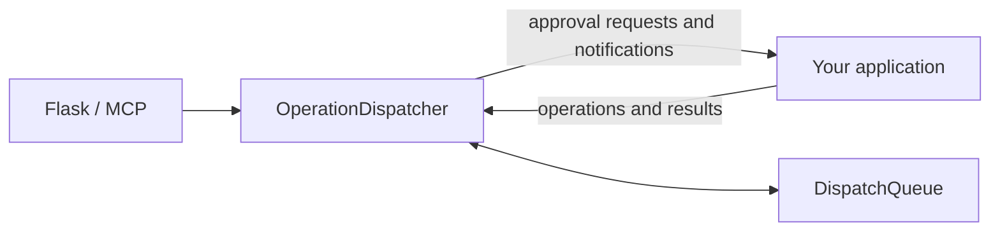
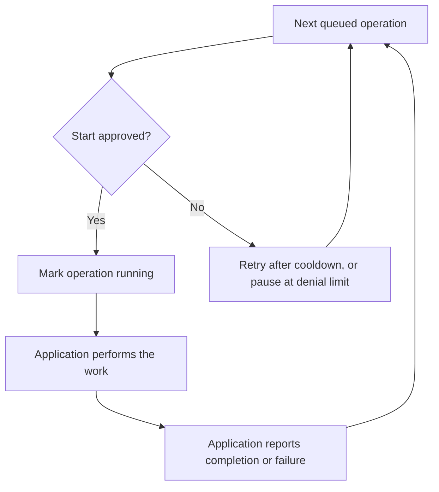

# Operation Dispatcher

Operation Dispatcher is a lightweight Python framework for scheduling and supervising operations for a **single resource**, such as a robot, machine, workstation, or transport vehicle. Each dispatcher maintains a queue, allows at most one active operation, requests approval for lifecycle actions, and records events and operation history.

Your application performs the actual work and reports completion or failure. The dispatcher coordinates that work; adding an operation or approving its start does not execute its payload.

## Highlights

- Configurable queue ordering by release date, priority, and creation time, with dependency ordering
- Async runtime with event wakeups and release-date/retry-cooldown waits
- Request callbacks for start, cancel, pause, and resume decisions
- Separate execution state, outcome, and termination reason
- Validated operation updates with field-level change events
- In-memory history, optional external history retrieval, diagnostics, and visualization
- Optional Flask/Swagger and FastMCP interfaces

## Architecture

The dispatcher manages the queue and operation lifecycle. Your application supplies business decisions, performs the work, and reports the result. Optional Flask and MCP interfaces expose control and inspection.



## Dispatch flow

One operation runs at a time. When the dispatcher is unpaused and idle, it waits for the queue head's release date and any retry cooldown before requesting approval.



Lifecycle events record what happened along the way. A paused operation keeps the active slot until it is completed, failed, or cancelled.

Scheduling behavior:

- Default ordering is `release_date` ascending (missing dates last), then `priority` descending, then `created_at` ascending. Supply `dispatch_queue_sort_rules` using `SortRule`, `SortField`, and `SortDirection` to customize it.
- `FINISH_TO_START` and `START_TO_START` dependencies both order providers before dependents **within the queued operations**. Cycles fall back to the configured sort order. Missing providers and their execution outcomes are not checked; enforce external dependency requirements in your request callback.
- A future release date or denied start on the queue head holds up later operations.
- `planned_duration` and `due_date` are metadata, not automatic completion or timeout triggers. Model timestamps are normalized to UTC; naive datetimes are treated as UTC.

## Installation

Requires **Python 3.12** (`>=3.12,<3.13`). From this checkout:

```bash
python -m pip install -e .
```

Install extras as needed (quote brackets when using shells such as zsh):

```bash
python -m pip install -e '.[dev]'       # pytest
python -m pip install -e '.[api]'       # Flask + Flasgger
python -m pip install -e '.[mcp]'       # FastMCP
python -m pip install -e '.[vis]'       # Plotly + NumPy + pandas
python -m pip install -e '.[dev,api,mcp,vis]'
```

## Quickstart

This example explicitly performs one dispatch step, simulates application work, and reports completion. Without a request callback, lifecycle requests are approved by default.

```python
import asyncio

from operation_dispatcher import DispatchEvent, Operation, OperationDispatcher


def on_notification(event: DispatchEvent) -> None:
    print(f"{event.event_type.value}: {event.operation_id}")


async def main() -> None:
    dispatcher = OperationDispatcher(
        resource_id="robot-1",
        on_notification_callback=on_notification,
    )
    operation = Operation(
        resource_id="robot-1",
        payload={"task": "pickup"},
        priority=10,
    )
    dispatcher.add_operation(operation)

    started = await dispatcher.step_dispatch()
    if started is not None:
        await asyncio.sleep(0.1)  # Replace with your resource integration.
        dispatcher.complete_operation(started.id)

    history = dispatcher.get_history(resolve_operations=True)
    print(history.model_dump_json(indent=2))


asyncio.run(main())
```

For continuous dispatch, start `runtime_task = asyncio.create_task(dispatcher.run())` in your asyncio application. Your resource integration must still call `complete_operation()` or `fail_operation()` for each active operation. To stop, call `dispatcher.request_stop()` and then `await runtime_task`. Stopping the loop preserves queued and active operations; it does not cancel them.

## Request decisions and notifications

`on_request_callback(event)` handles `OPERATION_START_REQUESTED`, `OPERATION_CANCEL_REQUESTED`, `OPERATION_PAUSE_REQUESTED`, and `OPERATION_RESUME_REQUESTED`. It can be synchronous or asynchronous. Retrieve the operation using `dispatcher.get_operation(event.operation_id)` when your decision needs its payload.

Return `True`/`False`, or a structured decision:

```python
from operation_dispatcher import DispatchEvent, EventType


def on_request(event: DispatchEvent) -> bool | dict[str, object]:
    if event.event_type is EventType.OPERATION_START_REQUESTED:
        return {
            "accepted": False,
            "reasoning": "resource_not_ready",
            "data": {"interlock": "loading_bay"},
        }
    return True
```

Pass it as `on_request_callback=on_request` when constructing the dispatcher. A configured callback returning `None` or another unsupported value **denies** the request. Callback exceptions and timeouts also produce denials. The request timeout defaults to 5 seconds; a timed-out synchronous callback may continue running in its worker thread.

Retry state is tracked per operation and request type. Defaults are a 1-second cooldown and a pause after 5 denials, configured by `start_request_retry_cooldown_seconds` and `start_request_max_retries`. Despite those parameter names, the same policy also applies to cancel, pause, and resume requests. Start requests are retried by the runtime; other actions require another caller invocation. `resume_dispatcher_runtime()` clears all request retry state.

`on_notification_callback(event)` observes dispatcher lifecycle events, operation transitions/updates, and denials. It supports synchronous and asynchronous callbacks; asynchronous notifications are scheduled without waiting for completion. `*_REQUESTED` events are recorded in history **after the decision**, with `meta_data["request_decision"]`, and are not sent to the notification callback. Denial events include retry metadata and any supplied reasoning/decision data.

## Models and lifecycle methods

Runtime tracking is part of `Operation`; there is no separate `OperationExecution` model.

| Model | Purpose |
| --- | --- |
| `Operation` | Payload, resource/job IDs, scheduling fields, execution state/outcome, timestamps, and retry count |
| `OperationDependency` | Provider operation ID and dependency type |
| `DispatchEvent` | Event type, resource/operation IDs, timestamp, metadata, and field-level `changes` |
| `OperationDispatcherState` | Running/paused flags, queued count, active operation, and uptime |
| `History` | Selected events, time window, and optionally referenced operations |

Execution state and terminal outcome are separate:

| Action | `state` | `outcome` |
| --- | --- | --- |
| Add a default operation | `QUEUED` | `NONE` |
| Approved start | `RUNNING` | `NONE` |
| Approved operation pause | `PAUSED` | Unchanged |
| Approved operation resume | `RUNNING` | Unchanged |
| `complete_operation(id)` | `COMPLETED` | `SUCCESS` |
| `fail_operation(id)` | `COMPLETED` | `FAILURE` |
| Approved `cancel_operation(id)` | `COMPLETED` | `CANCELLED` |

`termination_reason` supplies detail such as `USER_REQUEST`, `TIMEOUT`, `INTERNAL_ERROR`, or `EXTERNAL_ERROR`. Failure and cancellation default to `INTERNAL_ERROR`; pass an explicit reason when appropriate.

- `add_operation(operation)` validates the resource ID and queues it. `default_planned_duration` fills a missing duration unless disabled for that add call.
- `update_operation(id, updates)` validates allowed fields, reorders the queue, and emits `OPERATION_UPDATED` with changes when values differ. Updating an active `RUNNING` operation raises an error; `updatable_fields` can restrict the default field allowlist.
- `pause_operation(id)` / `resume_operation(id)` request approval for the current operation and enforce its expected state by default.
- `cancel_operation(id)` requests approval for a queued or active operation. Completion and failure require the current operation and do not request approval.
- `get_schedule()` returns queued operations only; `current_operation` returns the active one. `get_operation(id)` also searches archived operations.

Dispatcher pause and operation pause have different behavior. `pause_dispatcher_runtime()` blocks dispatch and directly marks any active operation `PAUSED`, without an operation pause handshake/event. `resume_dispatcher_runtime()` unblocks dispatch and clears retries, but does not restore the active operation to `RUNNING`; use `resume_operation(id)` for that transition. Neither runtime pause nor a state change automatically stops a physical resource.

## Events and history

All event enum names below use the `OPERATION_` prefix; serialized values are lowercase, for example `operation_started`.

| Group | Event names |
| --- | --- |
| Dispatcher lifecycle | `OPERATION_DISPATCHER_STARTED`, `OPERATION_DISPATCHER_STOPPED`, `OPERATION_DISPATCHER_PAUSED`, `OPERATION_DISPATCHER_RESUMED` |
| Requests | `OPERATION_START_REQUESTED`, `OPERATION_CANCEL_REQUESTED`, `OPERATION_PAUSE_REQUESTED`, `OPERATION_RESUME_REQUESTED` |
| Denials | `OPERATION_START_DENIED`, `OPERATION_CANCEL_DENIED`, `OPERATION_PAUSE_DENIED`, `OPERATION_RESUME_DENIED` |
| Operation lifecycle | `OPERATION_ADDED`, `OPERATION_UPDATED`, `OPERATION_STARTED`, `OPERATION_PAUSED`, `OPERATION_RESUMED`, `OPERATION_COMPLETED`, `OPERATION_FAILED`, `OPERATION_CANCELLED` |

The state store retains the most recent **1,000 events** in memory. Archived operations are kept separately in the queue's completed collection. There is no built-in durable persistence.

`get_history(from_time=None, to_time=None, resolve_operations=False, limit=None)` returns events in recorded order. Time bounds filter the selection; `limit` keeps the most recent matching events. With `resolve_operations=True`, the result includes the current operation objects referenced by those events, rather than historical snapshots.

For external history storage, supply `on_history_callback(from_time, to_time, resolve_operations, limit, in_memory_history)`. Return a `History` to override the in-memory selection, or `None` to keep it. Use notifications to integrate persistence for non-request events; request decisions remain available through history.

```python
from operation_dispatcher import HistoryAnalyzer, show_history_gantt

history = dispatcher.get_history(resolve_operations=True)
print(HistoryAnalyzer(history).get_report())
show_history_gantt(history, title="Dispatcher History")  # Requires .[vis].
```

`HistoryAnalyzer` reports dispatcher uptime and unpaused runtime in seconds and percentages. `BrowserEventVisualizer` provides a live browser view of events; the Plotly helpers build/show a history Gantt chart.

## Flask / OpenAPI interface

`OperationDispatcherOpenAPI.register_default_endpoints(app)` registers:

| Method | Route | Behavior |
| --- | --- | --- |
| GET | `/operations` | Active and queued operations; optional `state=QUEUED`, `RUNNING`, or `PAUSED` |
| GET | `/operations/current` | Current active operation |
| GET | `/operations/history` | Event history with optional referenced operations |
| GET | `/operations/<operation_id>` | Operation lookup, including archived operations |
| GET | `/operations/<operation_id>/events` | Retained in-memory events for the operation |
| POST | `/operations/add` | Add a non-empty list of operation objects |
| POST | `/operations/<operation_id>/update` | Update allowed operation fields |
| POST | `/operations/<operation_id>/cancel` | Request cancellation |
| POST | `/operations/<operation_id>/pause` | Request operation pause |
| POST | `/operations/<operation_id>/resume` | Request operation resume |
| GET | `/dispatcher` | Dispatcher/runtime state |
| POST | `/dispatcher/pause` | Pause dispatcher runtime |
| POST | `/dispatcher/resume` | Resume dispatcher runtime |

The history endpoint accepts `from_time` / `to_time` (ISO-8601), `resolve_operations` (default `true`), and `limit` (default 50, range 1–1000). Completed operations are retrieved through history or ID lookup, not the `/operations` list.

Runtime start/stop endpoints are available through `register_start_operation_dispatcher_endpoint(app)` and `register_stop_operation_dispatcher_endpoint(app)` at `/dispatcher/start` and `/dispatcher/stop`. They are **not registered by default**. When serving the same dispatcher through Flask and MCP, manage its runtime once in the host application; the MCP server lifespan only supplies dispatcher context.

## MCP interface

Install `.[mcp]` to use `OperationDispatcherMCPServer`, or register capabilities on an existing FastMCP app with `OperationDispatcherMCPUtility`.

- Tools: `dispatcher_get_state`, `dispatcher_pause_runtime`, `dispatcher_resume_runtime`, `dispatcher_get_history`
- Resources: `dispatcher://state`, `dispatcher://queue`, `dispatcher://history/{limit}`, `dispatcher://events/{limit}`, `dispatcher://operations/session/{operation_id}`, and `dispatcher://operations/session/{operation_id}/events`
- Prompt: `dispatcher_introduction_prompt`

These capabilities expose runtime control and inspection; operation add/update/complete/fail methods remain available through the Python facade (and selected actions through Flask).

## Examples and development

Run examples from the checkout after installing the relevant extras:

| Command | Demonstrates | Extras |
| --- | --- | --- |
| `python examples/dispatch_queue.py` | Queue ordering and lifecycle buckets | Base |
| `python examples/dispatcher.py` | Request callbacks, simulated work, and completion reporting | Base |
| `python examples/dispatcher_visualization.py` | Live browser event visualization | Base |
| `python examples/dispatcher_openapi.py` | Flask/Swagger with a browser event view | `api` |
| `python examples/dispatcher_mcp.py` | Standalone MCP service | `mcp` |
| `python examples/dispatcher_dual_interface.py` | Shared dispatcher with Flask, MCP, and visualization | `api,mcp` |
| `examples/history_gantt_and_KPIs.ipynb` | History Gantt and diagnostic report | `vis` + a notebook environment |

The OpenAPI demo serves Swagger at http://localhost:8000/, its schema at http://localhost:8000/openapi.json, and the event visualizer at http://localhost:8765/.

Run the test suite:

```bash
python -m pip install -e '.[dev,api]'
python -m pytest
```

Licensed under [GPLv3](LICENSE). Package version: `0.1.0`.
